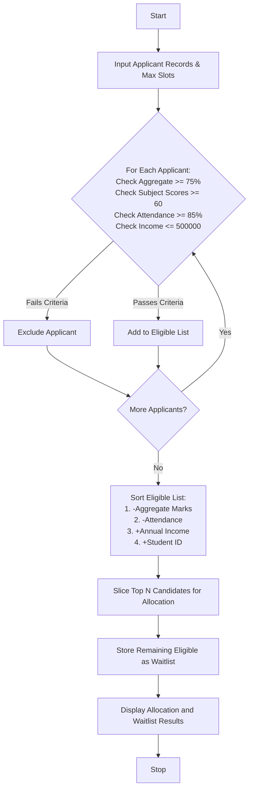

## Problem Statement

Design an automated University Scholarship Allocation System to process applicant records, evaluate eligibility based on academic and financial thresholds, rank qualified candidates, and resolve ties using a predefined priority hierarchy.

**Eligibility Criteria:**

* **Aggregate Marks:** $\ge 75.0\%$
* **Subject-wise Minimum Scores:** $\ge 60.0$ in every individual subject
* **Attendance:** $\ge 85.0\%$
* **Annual Family Income:** $\le \$500,000$

**Tie-Breaking Rules (Order of Priority):**

1. Higher aggregate marks (Descending)
2. Higher attendance percentage (Descending)
3. Lower annual family income (Ascending)
4. Alphabetical order of Student ID (Ascending)

---

## Algorithm

1. **Initialize:** Define eligibility thresholds (Aggregate $\ge 75\%$, Subject Minimum $\ge 60$, Attendance $\ge 85\%$, Income $\le \$500,000$) and the maximum available scholarship slots.
2. **Filter Applicants:** Iterate through each applicant record and verify if they satisfy all eligibility criteria. If true, include them in the eligible list; otherwise, exclude them.
3. **Sort and Rank:** Sort the eligible applicants using the tie-breaking hierarchy:
* Primary key: `-aggregate_marks` (descending)
* Secondary key: `-attendance` (descending)
* Tertiary key: `annual_income` (ascending)
* Quaternary key: `student_id` (ascending)


4. **Allocate Slots:** Assign scholarships to the top candidates up to the maximum available slot limit. Place remaining eligible candidates on a waitlist.
5. **Output:** Display the allocated students and waitlisted students.

---

## Flowchart



---


## Sample Input

```python
applicants = [
    {
        "student_id": "S101",
        "name": "Alice",
        "aggregate_marks": 88.5,
        "subject_scores": [85, 90, 82, 92],
        "attendance": 92.0,
        "annual_income": 300000,
    },
    {
        "student_id": "S102",
        "name": "Bob",
        "aggregate_marks": 88.5,
        "subject_scores": [80, 75, 85, 90],
        "attendance": 95.0,
        "annual_income": 250000,
    },
    {
        "student_id": "S103",
        "name": "Charlie",
        "aggregate_marks": 70.0,
        "subject_scores": [70, 70, 70, 70],
        "attendance": 90.0,
        "annual_income": 200000,
    },
    {
        "student_id": "S104",
        "name": "Diana",
        "aggregate_marks": 92.0,
        "subject_scores": [95, 90, 88, 95],
        "attendance": 88.0,
        "annual_income": 400000,
    },
    {
        "student_id": "S105",
        "name": "Ethan",
        "aggregate_marks": 85.0,
        "subject_scores": [55, 85, 90, 80],
        "attendance": 90.0,
        "annual_income": 350000,
    },
]
max_slots = 2

```

---

## Sample Output

```text
Allocated Scholarships:
ID: S104, Name: Diana, Marks: 92.0
ID: S102, Name: Bob, Marks: 88.5

Waitlisted Students:
ID: S101, Name: Alice, Marks: 88.5

```

> **Note:** Charlie is excluded due to aggregate marks below 75.0%. Ethan is excluded due to a subject score below the minimum threshold of 60. Bob and Alice tie on aggregate marks ($88.5\%$), but Bob ranks higher due to higher attendance ($95.0\%$ vs. $92.0\%$).
