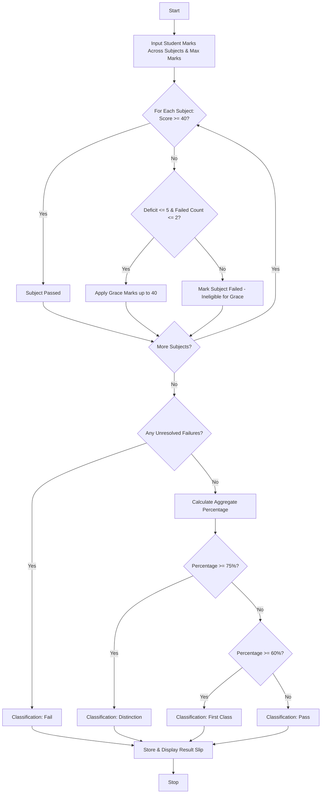

## Problem Statement

Design an Examination Result and Grace-Mark Validation System that processes student marks across multiple subjects, verifies subject-wise pass criteria, applies a conditional grace-mark policy for borderline failures without exceeding maximum possible subject marks, and generates final academic classifications (Distinction, First Class, Pass, or Fail).

**Grading & Policy Rules:**

* **Passing Mark:** $\ge 40.0$ in every subject.
* **Grace-Mark Policy:** If a student fails in up to $2$ subjects by a margin of $\le 5.0$ marks per subject, grace marks can be awarded to push them to the passing threshold ($40.0$), provided the adjusted score does not exceed the maximum mark limit ($100.0$).
* **Classifications:**
* *Distinction:* Aggregate percentage $\ge 75.0\%$ with no subject failures.
* *First Class:* Aggregate percentage $\ge 60.0\%$ with no subject failures.
* *Pass:* Aggregate percentage $\ge 40.0\%$ with all subjects passed (including via grace marks).
* *Fail:* Failed in one or more subjects even after applying grace marks.


---

## Algorithm

1. **Initialize:** Define passing thresholds, maximum subject marks, and grace-mark limits (max $5$ marks per subject, max $2$ failing subjects).
2. **Evaluate Individual Subjects:** Iterate through each student's subject scores:
* Identify subjects below the passing mark ($40.0$).
* Check if the failing margin is within the allowable grace limit ($\le 5.0$).


3. **Apply Grace Marks:** If eligible, add required grace marks to the failing subjects up to the passing threshold ($40.0$).
4. **Calculate Final Aggregate & Percentage:** Compute total marks earned out of maximum possible marks and determine the overall percentage.
5. **Classify Result:** Evaluate final status (Distinction, First Class, Pass, or Fail) based on percentage and subject pass status.
6. **Output Results:** Display student grade sheets, grace marks awarded, final percentages, and academic classifications.

---

## Flowchart



---

## Python Source Code

```python
def process_exam_results(student):
  scores = list(student["subject_scores"])
  num_subjects = len(scores)
  max_possible_marks = num_subjects * 100.0

  failing_indices = []
  for i, score in enumerate(scores):
    if score < 40.0:
      failing_indices.append(i)

  grace_marks_allocated = [0.0] * num_subjects
  is_eligible_for_grace = len(failing_indices) <= 2

  if is_eligible_for_grace:
    for idx in failing_indices:
      deficit = 40.0 - scores[idx]
      if deficit <= 5.0:
        grace_marks_allocated[idx] = deficit
        scores[idx] = 40.0
      else:
        is_eligible_for_grace = False
        break

  final_status = "Pass"
  has_failed = any(score < 40.0 for score in scores)

  if has_failed or (len(failing_indices) > 2 and not is_eligible_for_grace):
    final_status = "Fail"
    classification = "Fail"
  else:
    total_marks = sum(scores)
    percentage = (total_marks / max_possible_marks) * 100.0

    if percentage >= 75.0:
      classification = "Distinction"
    elif percentage >= 60.0:
      classification = "First Class"
    else:
      classification = "Pass"

  total_final_marks = sum(scores)
  final_percentage = (total_final_marks / max_possible_marks) * 100.0

  return {
      "student_id": student["student_id"],
      "name": student["name"],
      "original_scores": student["subject_scores"],
      "adjusted_scores": scores,
      "grace_marks": grace_marks_allocated,
      "total_marks": round(total_final_marks, 2),
      "percentage": round(final_percentage, 2),
      "classification": classification,
  }


if __name__ == "__main__":
  students = [
      {
          "student_id": "ST901",
          "name": "Alice Vance",
          "subject_scores": [85.0, 78.0, 92.0, 88.0, 90.0],
      },
      {
          "student_id": "ST902",
          "name": "Brian Miller",
          "subject_scores": [37.0, 65.0, 70.0, 72.0, 68.0],
      },
      {
          "student_id": "ST903",
          "name": "Clara Oswald",
          "subject_scores": [35.0, 36.0, 60.0, 55.0, 50.0],
      },
      {
          "student_id": "ST904",
          "name": "David Tennant",
          "subject_scores": [30.0, 32.0, 25.0, 45.0, 50.0],
      },
  ]

  print("=== EXAMINATION RESULTS & CLASSIFICATIONS ===")
  for s in students:
    res = process_exam_results(s)
    print(f"ID: {res['student_id']} | Name: {res['name']}")
    print(f"Original Scores: {res['original_scores']}")
    print(f"Adjusted Scores: {res['adjusted_scores']}")
    print(f"Grace Marks Added: {res['grace_marks']}")
    print(f"Total Marks: {res['total_marks']} / 500 | Percentage: {res['percentage']}%")
    print(f"Classification: {res['classification']}")
    print("-" * 55)

```
