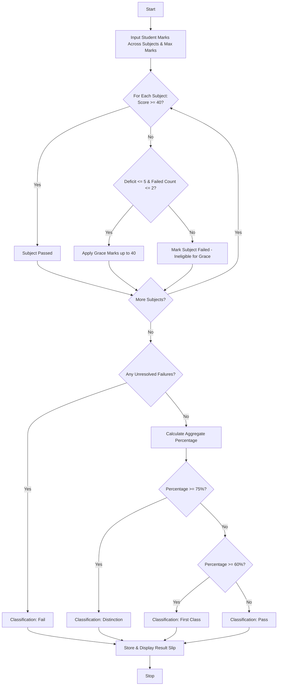

## Problem Statement

Design an Examination Result and Grace-Mark Validation System that processes student marks across multiple subjects, verifies subject-wise pass criteria, applies a conditional grace-mark policy for borderline failures without exceeding maximum possible subject marks, and generates final academic classifications (Distinction, First Class, Pass, or Fail).

**Grading & Policy Rules:**

* **Passing Mark:** $\ge 40.0$ in every subject.
* **Grace-Mark Policy:** If a student fails in up to $2$ subjects by a margin of $\le 5.0$ marks per subject, grace marks can be awarded to push them to the passing threshold ($40.0$), provided the adjusted score does not exceed the maximum mark limit ($100.0$).
* **Classifications:**
* *Distinction:* Aggregate percentage $\ge 75.0\%$ with no subject failures.
* *First Class:* Aggregate percentage $\ge 60.0\%$ with no subject failures.
* *Pass:* Aggregate percentage $\ge 40.0\%$ with all subjects passed (including via grace marks).
* *Fail:* Failed in one or more subjects even after applying grace marks.

---

## Algorithm

1. **Initialize:** Define passing thresholds, maximum subject marks, and grace-mark limits (max $5$ marks per subject, max $2$ failing subjects).
2. **Evaluate Individual Subjects:** Iterate through each student's subject scores:
* Identify subjects below the passing mark ($40.0$).
* Check if the failing margin is within the allowable grace limit ($\le 5.0$).

3. **Apply Grace Marks:** If eligible, add required grace marks to the failing subjects up to the passing threshold ($40.0$).
4. **Calculate Final Aggregate & Percentage:** Compute total marks earned out of maximum possible marks and determine the overall percentage.
5. **Classify Result:** Evaluate final status (Distinction, First Class, Pass, or Fail) based on percentage and subject pass status.
6. **Output Results:** Display student grade sheets, grace marks awarded, final percentages, and academic classifications.

---

## Flowchart

---

