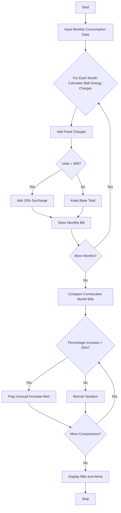

## Problem Statement

Design a Progressive Electricity Billing and Anomaly Detection System that calculates monthly electricity costs based on tiered consumption slabs, fixed base charges, progressive surcharges, and evaluates historical consumption across multiple months to flag unusual cost increases or consumption spikes.

**Tariff Slab Structure:**

* **Slab 1 (0 – 100 units):** $\$3.50$ per unit
* **Slab 2 (101 – 300 units):** $\$5.00$ per unit
* **Slab 3 (Above 300 units):** $\$7.00$ per unit
* **Fixed Charges:** $\$50.00$ per month
* **Surcharge:** $10\%$ on energy charges if total consumption exceeds $400$ units.

**Anomaly Detection Rule:**

* Flag any month where the total bill increases by more than $25.0\%$ compared to the immediately preceding month.

---

## Algorithm

1. **Initialize Tariff Parameters:** Set up slab limits, unit rates, fixed charges, and surcharge conditions.
2. **Calculate Monthly Bill:** For each month's total units consumed:
* Compute energy charges progressively across the slabs.
* Add the standard fixed charge.
* Apply a surcharge if units exceed the high-consumption threshold.


3. **Analyze Trends:** Iterate through the historical list of monthly bills.
* Compare each month's bill to the previous month.
* Calculate percentage increase. If it exceeds $25\%$, trigger an anomaly alert.


4. **Output Results:** Display the calculated bill for each month alongside any detected billing anomalies.

---

## Flowchart



---

## Python Source Code

```python
def calculate_bill(units):
  fixed_charge = 50.0
  energy_charge = 0.0

  if units <= 100:
    energy_charge = units * 3.5
  elif units <= 300:
    energy_charge = (100 * 3.5) + ((units - 100) * 5.0)
  else:
    energy_charge = (100 * 3.5) + (200 * 5.0) + ((units - 300) * 7.0)

  surcharge = 0.0
  if units > 400:
    surcharge = energy_charge * 0.10

  total_bill = fixed_charge + energy_charge + surcharge
  return round(total_bill, 2)


def analyze_consumption(monthly_data):
  bills = {}
  for month, units in monthly_data.items():
    bills[month] = calculate_bill(units)

  alerts = []
  months = list(bills.keys())
  for i in range(1, len(months)):
    prev_month = months[i - 1]
    curr_month = months[i]
    prev_bill = bills[prev_month]
    curr_bill = bills[curr_month]

    if prev_bill > 0:
      increase_pct = ((curr_bill - prev_bill) / prev_bill) * 100
      if increase_pct > 25.0:
        alerts.append(
            f"Unusual increase detected in {curr_month}: Bill jumped by"
            f" {increase_pct:.1f}% compared to {prev_month}"
        )

  return bills, alerts


if __name__ == "__main__":
  consumption_data = {
      "January": 150,
      "February": 180,
      "March": 210,
      "April": 190,
      "May": 450,
      "June": 470,
  }

  bills, alerts = analyze_consumption(consumption_data)

  print("Monthly Bills:")
  for month, bill in bills.items():
    print(f"{month}: ${bill}")

  print("\nAnomaly Detection Alerts:")
  for alert in alerts:
    print(alert)

```

---

## Sample Input

```python
consumption_data = {
    "January": 150,
    "February": 180,
    "March": 210,
    "April": 190,
    "May": 450,
    "June": 470,
}

```

---

## Sample Output

```text
Monthly Bills:
January: $475.0
February: $590.0
March: $705.0
April: $625.0
May: $1845.0
June: $1924.5

Anomaly Detection Alerts:
Unusual increase detected in May: Bill jumped by 195.2% compared to April

```
