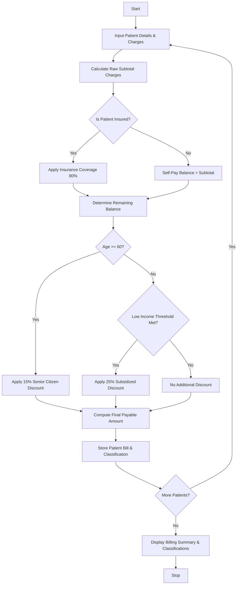

## Problem Statement

Design a Hospital Billing and Patient Classification System that processes patient charges (consultation, diagnostics, treatment, and room rent), applies conditional concessions based on age and insurance coverage, validates billing constraints, and classifies patients into appropriate payment tiers with final payable calculations.

**Policy & Concession Rules:**

* **Subtotal Calculation:** Consultation + Diagnostics + Treatment + (Daily Room Rate $\times$ Days Stayed).
* **Patient Classification & Discounts:**
* *Insured:* Covered by health insurance (Insurance covers $80\%$ of total charges).
* *Senior Citizen (Age $\ge 60$):* Eligible for a $15\%$ senior discount on the remaining self-pay balance.
* *Subsidized / Low-Income:* Annual income below a threshold qualifies for a $25\%$ charity concession.
* *General:* Standard self-pay tier with no special concessions.


* **Billing Constraints:** Minimum deposit verification and zero/negative charge validation.

---

## Algorithm

1. **Initialize:** Define insurance coverage rates, age thresholds, and concession percentages.
2. **Calculate Base Charges:** Compute the raw subtotal for each patient by summing consultation, diagnostics, treatment, and accommodation costs.
3. **Classify Patient:** Evaluate insurance status, age, and income to assign a primary patient classification tier.
4. **Apply Concessions & Insurance:**
* If insured, deduct the insurance coverage portion.
* If senior citizen or low-income, apply the corresponding discount to the applicable balance.


5. **Finalize Bill:** Determine the net amount payable by the patient and balance covered by insurance/discounts.
6. **Output:** Display the itemized bill, patient classification category, and final settlement details.

---

## Flowchart




## Sample Input

```python
patients = [
    {
        "patient_id": "P501",
        "name": "Robert Smith",
        "age": 65,
        "is_insured": False,
        "annual_income": 400000,
        "consultation": 1500,
        "diagnostics": 3500,
        "treatment": 10000,
        "room_rate": 2000,
        "days_stayed": 4,
    },
    {
        "patient_id": "P502",
        "name": "Emily Davis",
        "age": 28,
        "is_insured": True,
        "annual_income": 600000,
        "consultation": 2000,
        "diagnostics": 5000,
        "treatment": 25000,
        "room_rate": 3000,
        "days_stayed": 3,
    },
    {
        "patient_id": "P503",
        "name": "Michael Brown",
        "age": 42,
        "is_insured": False,
        "annual_income": 180000,
        "consultation": 1000,
        "diagnostics": 2000,
        "treatment": 8000,
        "room_rate": 1500,
        "days_stayed": 2,
    },
]

```

---

## Sample Output

```text
Patient ID: P501 (Robert Smith)
Classification: Senior Citizen
Total Charges: $23000.0
Insurance Covered: $0.0
Discount Applied: $3450.0
Net Payable: $19550.0
----------------------------------------
Patient ID: P502 (Emily Davis)
Classification: Insured
Total Charges: $41000.0
Insurance Covered: $32800.0
Discount Applied: $0.0
Net Payable: $8200.0
----------------------------------------
Patient ID: P503 (Michael Brown)
Classification: Subsidized / Charity
Total Charges: $14000.0
Insurance Covered: $0.0
Discount Applied: $3500.0
Net Payable: $10500.0
----------------------------------------

```
