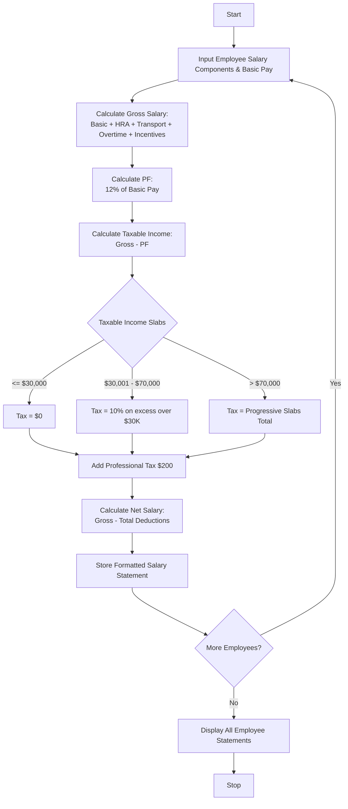

## Problem Statement

Design an Employee Payroll and Deduction Analysis System that computes gross salary from basic pay, house rent allowance (HRA), transport allowance, overtime compensation, and performance incentives. The system then applies progressive tax deductions, provident fund (PF) contributions, and professional tax, generates net take-home pay, and compiles a formatted salary statement.

**Payroll & Deduction Rules:**

* **Gross Salary:** Basic Pay + HRA + Transport Allowance + Overtime Pay + Incentives
* **Provident Fund (PF):** $12.0\%$ of Basic Pay
* **Professional Tax:** Flat fee ($\$200.00$)
* **Progressive Income Tax Slabs on Taxable Income:**
* Up to $\$30,000$: $0\%$
* $\$30,001$ – $\$70,000$: $10\%$
* Above $\$70,000$: $20\%$


* **Net Salary:** Gross Salary - (PF + Professional Tax + Income Tax)

---

## Algorithm

1. **Initialize Pay Parameters:** Set up allowance formulas, PF rates, professional tax, and income tax bracket thresholds.
2. **Calculate Gross Earnings:** Sum Basic Pay, HRA, Transport Allowance, Overtime compensation, and Incentives for each employee.
3. **Compute Deductions:**
* Calculate Provident Fund as $12\%$ of Basic Pay.
* Assign the fixed Professional Tax.
* Determine Taxable Income (Gross minus standard exemptions or deductions, or directly on gross/basic depending on policy; here, Gross minus PF).
* Apply progressive income tax slabs to determine the income tax amount.


4. **Determine Net Salary:** Subtract all deductions from the gross salary.
5. **Output Results:** Generate and display a structured, formatted salary statement for each employee.

---

## Flowchart




  


---

## Sample Input

```python
employees = [
    {
        "emp_id": "E201",
        "name": "Sarah Connor",
        "basic_pay": 45000,
        "hra": 15000,
        "transport": 5000,
        "overtime_pay": 3000,
        "incentives": 5000,
    },
    {
        "emp_id": "E202",
        "name": "John Reese",
        "basic_pay": 60000,
        "hra": 20000,
        "transport": 6000,
        "overtime_pay": 4000,
        "incentives": 10000,
    },
    {
        "emp_id": "E203",
        "name": "Miles Dyson",
        "basic_pay": 30000,
        "hra": 10000,
        "transport": 3000,
        "overtime_pay": 1000,
        "incentives": 2000,
    },
]

```

---

## Sample Output

```text
Employee ID: E201 (Sarah Connor)
Gross Salary: $73000.0
Deductions -> PF: $5400.0, Prof Tax: $200.0, Income Tax: $6860.0
Total Deductions: $12460.0
Net Take-Home Salary: $60540.0
--------------------------------------------------
Employee ID: E202 (John Reese)
Gross Salary: $100000.0
Deductions -> PF: $7200.0, Prof Tax: $200.0, Income Tax: $10040.0
Total Deductions: $17440.0
Net Take-Home Salary: $82560.0
--------------------------------------------------
Employee ID: E203 (Miles Dyson)
Gross Salary: $46000.0
Deductions -> PF: $3600.0, Prof Tax: $200.0, Income Tax: $3240.0
Total Deductions: $7040.0
Net Take-Home Salary: $38960.0
--------------------------------------------------

```
