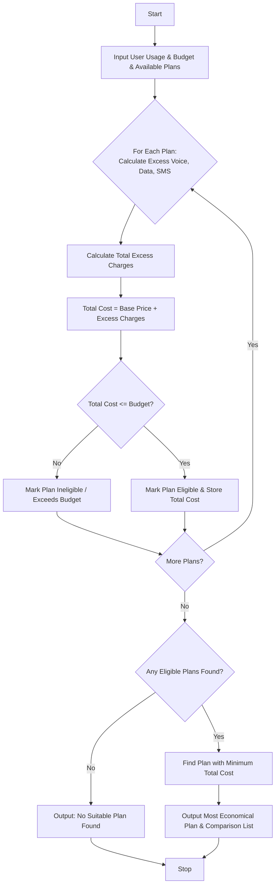

## Problem Statement

Design a Multi-Plan Telecommunications Cost Optimization System that evaluates multiple mobile carrier plans against a user's projected monthly usage (voice minutes, data in GB, SMS count), validity period, and budget constraints. The system calculates base costs, computes excess usage fees for exceeding plan allowances, and identifies the single most economical eligible plan.

**Plan Evaluation Rules:**

* **Included Allowances:** Each plan specifies free voice minutes, data GBs, and SMS messages for its validity period.
* **Excess Usage Charges:**
* Excess Voice: $\$0.50$ per minute over the limit
* Excess Data: $\$10.00$ per GB over the limit
* Excess SMS: $\$0.10$ per message over the limit


* **Eligibility Constraint:** The total calculated cost (base plan price + excess charges) must be less than or equal to the user's maximum budget.

---

## Algorithm

1. **Initialize:** Define user consumption requirements (voice minutes, data GBs, SMS count) and maximum budget.
2. **Filter Plans:** Iterate through each available telecommunications plan and check if its total cost (base price + excess charges) is within the user's budget.
3. **Calculate Costs:** For each eligible plan:
* Compute excess voice minutes, data, and SMS.
* Calculate total excess fees.
* Add excess fees to the plan's base price to determine the total effective cost.


4. **Identify Optimal Plan:** Compare the total effective costs of all eligible plans and select the one with the minimum cost.
5. **Output Results:** Display the evaluation results for all plans and highlight the most economical eligible plan.

---

## Flowchart




## Sample Input

```python
user_usage = {"voice_mins": 450, "data_gb": 12, "sms_count": 100}
max_budget = 60.0

plans = [
    {
        "plan_name": "Basic Saver",
        "base_price": 30.0,
        "voice_limit": 300,
        "data_limit": 5,
        "sms_limit": 50,
    },
    {
        "plan_name": "Standard Plus",
        "base_price": 45.0,
        "voice_limit": 500,
        "data_limit": 10,
        "sms_limit": 200,
    },
    {
        "plan_name": "Unlimited Ultra",
        "base_price": 70.0,
        "voice_limit": 1000,
        "data_limit": 30,
        "sms_limit": 500,
    },
]

```

---

## Sample Output

```text
Plan Evaluation Summary:
Plan: Basic Saver | Base: $30.0 | Excess: $110.0 | Total: $140.0 | Status: Ineligible / Over Budget
Plan: Standard Plus | Base: $45.0 | Excess: $25.0 | Total: $70.0 | Status: Ineligible / Over Budget
Plan: Unlimited Ultra | Base: $70.0 | Excess: $0.0 | Total: $70.0 | Status: Ineligible / Over Budget
------------------------------------------------------------
No plans fit the budget and usage requirements.

```
