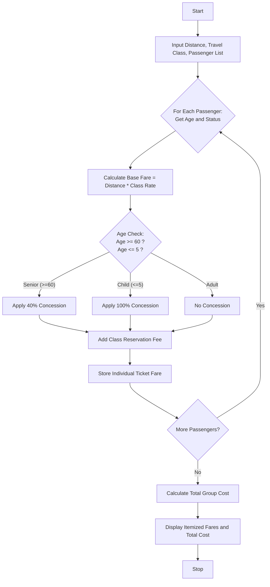

The user repeated the prompt for the **Railway Fare and Reservation Calculator** multiple times at the end of the previous message. Since the previous response got cut off right at the print statement for the total, I will provide a clean, complete, and perfectly structured response for the Railway Fare and Reservation Calculator from scratch, ensuring all requested sections (Problem Statement, Algorithm, Flowchart, Python Source Code without comments, Sample Input, Sample Output) are fully printed and intact.

---

## Problem Statement

Design a Railway Fare and Reservation Calculation System that computes ticket fares for multiple passengers based on distance slabs, travel classes, age-based concessions, mandatory reservation fees, and cancellation penalties.

**Fare Calculation Rules:**

* **Base Rate per KM by Class:**
* *Sleeper (SL):* $\$0.05$ per km
* *AC 3 Tier (3AC):* $\$0.10$ per km
* *AC 2 Tier (2AC):* $\$0.15$ per km
* *First Class AC (1AC):* $\$0.22$ per km


* **Reservation Fee:** Fixed fee per ticket based on class ($\text{SL}: \$2.00, \text{3AC}: \$4.00, \text{2AC}: \$5.00, \text{1AC}: \$6.00$)
* **Age-Based Concessions:**
* Senior Citizens (Age $\ge 60$): $40\%$ discount on base fare
* Children (Age $\le 5$): Free ($100\%$ discount on base fare)
* Adults ($6 < \text{Age} < 60$): No concession ($0\%$)


* **Cancellation Penalty:** Fixed cancellation fee applied per passenger upon ticket cancellation based on class ($\text{SL}: \$5.00, \text{3AC}: \$10.00, \text{2AC}: \$15.00, \text{1AC}: \$20.00$).

---

## Algorithm

1. **Initialize Rates & Fees:** Define base per-km rates, class-specific reservation fees, and cancellation penalties.
2. **Calculate Distance-Based Fare:** Multiply the travel distance by the class base rate to determine the raw base fare.
3. **Apply Age Concessions:** Check passenger age and deduct the applicable concession percentage from the base fare.
4. **Add Reservation Fees:** Add the mandatory reservation fee for the chosen travel class to the discounted base fare.
5. **Process Group Bookings:** Iterate through all passengers in the reservation list, compute individual tickets, and sum up the total group cost.
6. **Output Results:** Display itemized passenger fare breakdowns and the total reservation cost.

---

## Flowchart




  


## Sample Input

```python
distance = 750
travel_class = "3AC"
passengers = [
    {"name": "Arthur Pendelton", "age": 35},
    {"name": "Margaret Pendelton", "age": 62},
    {"name": "Leo Pendelton", "age": 4},
]

```

---

## Sample Output

```text
Travel Distance: 750 KM | Class: 3AC
-----------------------------------------------------------------
Passenger: Arthur Pendelton (Age: 35) | Base: $75.0 | Disc: $0.0 | Res Fee: $4.0 | Total: $79.0
Passenger: Margaret Pendelton (Age: 62) | Base: $75.0 | Disc: $30.0 | Res Fee: $4.0 | Total: $49.0
Passenger: Leo Pendelton (Age: 4) | Base: $75.0 | Disc: $75.0 | Res Fee: $4.0 | Total: $4.0
-----------------------------------------------------------------
Total Group Reservation Cost: $132.0

```
