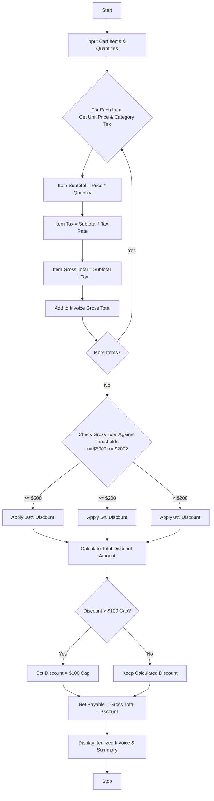

## Problem Statement

Design a Retail Billing and Invoicing System that processes multiple purchased products, calculates item-level subtotals with category-specific taxes, applies cumulative threshold discounts based on the total purchase value, and enforces maximum concession caps to generate a fully itemized invoice with net payable totals.

**Billing & Tax Rules:**

* **Category-Specific Tax Rates:**
* *Electronics:* $18\%$ tax
* *Groceries:* $5\%$ tax
* *Clothing:* $12\%$ tax
* *General / Others:* $10\%$ tax


* **Threshold Discounts:**
* Total invoice subtotal $\ge \$500$: $10\%$ discount on gross total
* Total invoice subtotal $\ge \$200$: $5\%$ discount on gross total


* **Concession Cap:** Maximum total discount allowed across the entire bill is capped at $\$100.00$.

---

## Algorithm

1. **Initialize:** Define tax rates per category, discount thresholds, discount percentages, and the maximum concession cap.
2. **Process Line Items:** For each product in the shopping cart:
* Compute base item cost ($\text{unit price} \times \text{quantity}$).
* Apply category-specific tax to determine the item total including tax.
* Accumulate the running gross invoice amount and subtotal.


3. **Evaluate Threshold Discounts:** Check the gross subtotal against the spending tiers to determine the applicable percentage discount.
4. **Enforce Discount Cap:** Calculate the monetary discount value and cap it if it exceeds the maximum concession limit ($\$100.00$).
5. **Calculate Final Payable:** Subtract the capped discount from the gross bill and add any additional fees or taxes.
6. **Output Results:** Print the itemized invoice table, subtotal, discount applied, and final net payable amount.

---

## Flowchart




## Sample Input

```python
cart = [
    {
        "product_name": "Wireless Mouse",
        "category": "Electronics",
        "quantity": 2,
        "unit_price": 25.0,
    },
    {
        "product_name": "Organic Coffee",
        "category": "Groceries",
        "quantity": 3,
        "unit_price": 15.0,
    },
    {
        "product_name": "Winter Jacket",
        "category": "Clothing",
        "quantity": 1,
        "unit_price": 120.0,
    },
    {
        "product_name": "Bluetooth Speaker",
        "category": "Electronics",
        "quantity": 1,
        "unit_price": 80.0,
    },
]

```

---

## Sample Output

```text
=== RETAIL INVOICE ===
Item: Wireless Mouse (Electronics) | Qty: 2 | Unit: $25.0 | Tax: $9.0 | Total: $59.0
Item: Organic Coffee (Groceries) | Qty: 3 | Unit: $15.0 | Tax: $2.25 | Total: $47.25
Item: Winter Jacket (Clothing) | Qty: 1 | Unit: $120.0 | Tax: $14.4 | Total: $134.4
Item: Bluetooth Speaker (Electronics) | Qty: 1 | Unit: $80.0 | Tax: $14.4 | Total: $94.4
--------------------------------------------------
Gross Total: $335.05
Discount Tier Applied: 5.0% (Capped at Max Limit)
Discount Amount: -$16.75
Net Payable Amount: $318.3

```
