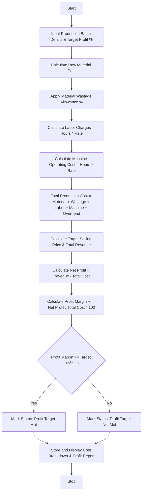

## Problem Statement

Design a Manufacturing Cost and Profitability Analysis System that computes total production costs by integrating raw material expenses, direct labor charges, material wastage allowances, and machine operational overheads. The system then calculates unit selling prices, total revenues, net profit margins, and evaluates whether production meets or exceeds a specified target profit percentage.

**Cost & Profitability Rules:**

* **Material Cost:** Sum of raw material requirements multiplied by respective unit costs.
* **Wastage Allowance:** Added percentage surcharge (e.g., $5.0\%$ of material cost) accounting for production scrap/wastage.
* **Labor & Machine Cost:** Direct labor hours multiplied by hourly rates, plus machine operational hours multiplied by machine maintenance/power rates.
* **Total Production Cost:** Material Cost + Wastage + Labor Cost + Machine Cost + Overhead.
* **Target Profit:** Profitability target percentage (e.g., $\ge 20.0\%$ net profit margin on total production cost).

---

## Algorithm

1. **Initialize Production Parameters:** Set up unit costs for raw materials, wastage rates, labor rates, machine operational rates, and the target profit margin.
2. **Calculate Direct Costs:** Compute raw material expenses and apply the wastage percentage.
3. **Calculate Indirect Costs:** Compute total labor charges and machine operational overhead costs.
4. **Determine Total Production Cost:** Sum up material costs, wastage, labor charges, machine operational costs, and fixed overheads.
5. **Evaluate Profitability:**
* Calculate selling price and expected revenue based on units produced.
* Compute net profit and profit margin percentage.
* Compare profit margin against the target profit threshold.


6. **Output Results:** Display the cost breakdown sheet, total production cost, actual profit margin, and target achievement status.

---

## Flowchart



---

## Python Source Code

```python
def analyze_manufacturing_profitability(batch_data, target_profit_pct):
  raw_material_cost = sum(
      item["quantity"] * item["unit_cost"]
      for item in batch_data["raw_materials"]
  )
  wastage_cost = raw_material_cost * batch_data["wastage_pct"]
  adjusted_material_cost = raw_material_cost + wastage_cost

  labor_cost = batch_data["labor_hours"] * batch_data["labor_rate_per_hour"]
  machine_cost = (
      batch_data["machine_hours"] * batch_data["machine_rate_per_hour"]
  )
  overhead_cost = batch_data["fixed_overhead"]

  total_production_cost = (
      adjusted_material_cost + labor_cost + machine_cost + overhead_cost
  )
  cost_per_unit = total_production_cost / batch_data["units_produced"]

  total_revenue = batch_data["units_produced"] * batch_data["selling_price_per_unit"]
  net_profit = total_revenue - total_production_cost
  profit_margin_pct = (net_profit / total_production_cost) * 100

  target_met = profit_margin_pct >= target_profit_pct

  return {
      "product_name": batch_data["product_name"],
      "units_produced": batch_data["units_produced"],
      "raw_material_cost": round(raw_material_cost, 2),
      "wastage_cost": round(wastage_cost, 2),
      "labor_cost": round(labor_cost, 2),
      "machine_cost": round(machine_cost, 2),
      "overhead_cost": round(overhead_cost, 2),
      "total_production_cost": round(total_production_cost, 2),
      "cost_per_unit": round(cost_per_unit, 2),
      "total_revenue": round(total_revenue, 2),
      "net_profit": round(net_profit, 2),
      "profit_margin_pct": round(profit_margin_pct, 2),
      "target_met": target_met,
  }


if __name__ == "__main__":
  batch = {
      "product_name": "Industrial Electric Motor",
      "units_produced": 500,
      "raw_materials": [
          {"material": "Copper Wire (kg)", "quantity": 100, "unit_cost": 12.5},
          {"material": "Steel Housing (units)", "quantity": 500, "unit_cost": 15.0},
          {"material": "Bearings (units)", "quantity": 1000, "unit_cost": 3.0},
      ],
      "wastage_pct": 0.05,
      "labor_hours": 200,
      "labor_rate_per_hour": 25.0,
      "machine_hours": 150,
      "machine_rate_per_hour": 40.0,
      "fixed_overhead": 5000.0,
      "selling_price_per_unit": 65.0,
  }

  target_profit = 20.0
  report = analyze_manufacturing_profitability(batch, target_profit)

  print(f"Manufacturing Report: {report['product_name']}")
  print(f"Units Produced: {report['units_produced']}")
  print("-" * 50)
  print(f"Raw Material Cost: ${report['raw_material_cost']}")
  print(f"Wastage Allowance (5%): ${report['wastage_cost']}")
  print(f"Direct Labor Cost: ${report['labor_cost']}")
  print(f"Machine Operating Cost: ${report['machine_cost']}")
  print(f"Fixed Overheads: ${report['overhead_cost']}")
  print(f"Total Production Cost: ${report['total_production_cost']}")
  print(f"Cost Per Unit: ${report['cost_per_unit']}")
  print("-" * 50)
  print(f"Total Revenue: ${report['total_revenue']}")
  print(f"Net Profit: ${report['net_profit']}")
  print(f"Actual Profit Margin: {report['profit_margin_pct']}%")
  print(f"Target Profit Threshold: {target_profit}%")
  
  status = "YES (Target Achieved)" if report['target_met'] else "NO (Target Missed)"
  print(f"Meets Profit Target: {status}")

```

---

## Sample Input

```python
batch = {
    "product_name": "Industrial Electric Motor",
    "units_produced": 500,
    "raw_materials": [
        {"material": "Copper Wire (kg)", "quantity": 100, "unit_cost": 12.5},
        {"material": "Steel Housing (units)", "quantity": 500, "unit_cost": 15.0},
        {"material": "Bearings (units)", "quantity": 1000, "unit_cost": 3.0},
    ],
    "wastage_pct": 0.05,
    "labor_hours": 200,
    "labor_rate_per_hour": 25.0,
    "machine_hours": 150,
    "machine_rate_per_hour": 40.0,
    "fixed_overhead": 5000.0,
    "selling_price_per_unit": 65.0,
}
target_profit = 20.0

```

---

## Sample Output

```text
Manufacturing Report: Industrial Electric Motor
Units Produced: 500
--------------------------------------------------
Raw Material Cost: $11250.0
Wastage Allowance (5%): $562.5
Direct Labor Cost: $5000.0
Machine Operating Cost: $6000.0
Fixed Overheads: $5000.0
Total Production Cost: $27812.5
Cost Per Unit: $55.63
--------------------------------------------------
Total Revenue: $32500.0
Net Profit: $4687.5
Actual Profit Margin: 16.85%
Target Profit Threshold: 20.0%
Meets Profit Target: NO (Target Missed)

```
