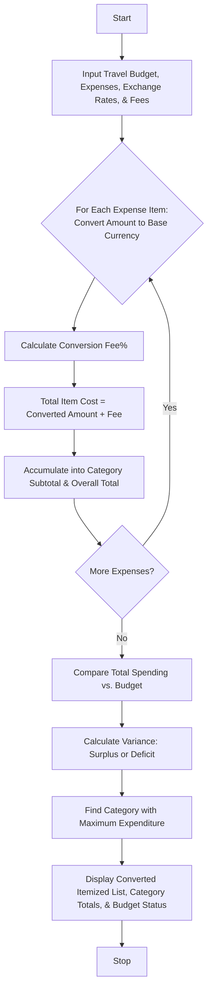

## Problem Statement

Design a Multi-Currency Travel Budget Analysis System that processes international travel expenses incurred in various foreign currencies, converts them into a base home currency using supplied exchange rates, incorporates currency conversion fees, compares total spending against a travel budget, and identifies the largest expense category.

**Conversion & Budget Rules:**

* **Currency Conversion:** $\text{Converted Amount} = \text{Foreign Amount} \times \text{Exchange Rate}$
* **Conversion Fee:** A percentage fee (e.g., $2.5\%$) added to each converted transaction.
* **Budget Comparison:** Compute total expenditures across all categories and compare against the traveler's total budget to determine surplus or deficit.
* **Category Analysis:** Aggregate expenses by category (e.g., Accommodation, Transport, Food, Entertainment) to determine which category consumes the largest share of the budget.

---

## Algorithm

1. **Initialize:** Define exchange rates relative to the base currency, conversion fee percentage, travel budget, and expense categories.
2. **Process Expenses:** Iterate through each recorded expense item:
* Convert foreign currency amount to base currency.
* Calculate conversion fee.
* Compute total item cost in base currency.


3. **Categorize and Aggregate:** Group item costs by expense category and compute category subtotals. Accumulate the overall total travel spending.
4. **Compare Budget:** Subtract total spending from the total budget to find the remaining balance or deficit.
5. **Identify Maximum Category:** Find the expense category with the highest total expenditure.
6. **Output Results:** Display itemized converted expenses, category summaries, budget status, and the largest expense category.

---

## Flowchart




## Sample Input

```python
total_budget = 2500.0
conversion_fee = 0.025

exchange_rates = {
    "EUR": 1.10,
    "GBP": 1.30,
    "JPY": 0.0065,
    "USD": 1.00
}

expenses = [
    {"description": "Hotel Stay Paris", "category": "Accommodation", "foreign_amount": 800.0, "currency": "EUR"},
    {"description": "Bullet Train Tokyo", "category": "Transport", "foreign_amount": 45000.0, "currency": "JPY"},
    {"description": "Dinner in London", "category": "Food", "foreign_amount": 120.0, "currency": "GBP"},
    {"description": "Museum Tickets", "category": "Entertainment", "foreign_amount": 75.0, "currency": "EUR"},
    {"description": "Taxi Ride", "category": "Transport", "foreign_amount": 45.0, "currency": "GBP"},
]

```
