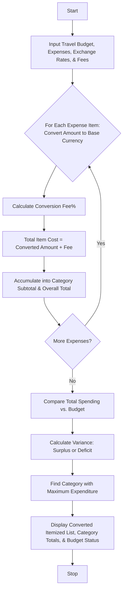

## Problem Statement

Design a Multi-Currency Travel Budget Analysis System that processes international travel expenses incurred in various foreign currencies, converts them into a base home currency using supplied exchange rates, incorporates currency conversion fees, compares total spending against a travel budget, and identifies the largest expense category.

**Conversion & Budget Rules:**

* **Currency Conversion:** $\text{Converted Amount} = \text{Foreign Amount} \times \text{Exchange Rate}$
* **Conversion Fee:** A percentage fee (e.g., $2.5\%$) added to each converted transaction.
* **Budget Comparison:** Compute total expenditures across all categories and compare against the traveler's total budget to determine surplus or deficit.
* **Category Analysis:** Aggregate expenses by category (e.g., Accommodation, Transport, Food, Entertainment) to determine which category consumes the largest share of the budget.

---

## Algorithm

1. **Initialize:** Define exchange rates relative to the base currency, conversion fee percentage, travel budget, and expense categories.
2. **Process Expenses:** Iterate through each recorded expense item:
* Convert foreign currency amount to base currency.
* Calculate conversion fee.
* Compute total item cost in base currency.


3. **Categorize and Aggregate:** Group item costs by expense category and compute category subtotals. Accumulate the overall total travel spending.
4. **Compare Budget:** Subtract total spending from the total budget to find the remaining balance or deficit.
5. **Identify Maximum Category:** Find the expense category with the highest total expenditure.
6. **Output Results:** Display itemized converted expenses, category summaries, budget status, and the largest expense category.

---

## Flowchart



---

## Python Source Code

```python
def analyze_travel_budget(budget, expenses, exchange_rates, conversion_fee_pct):
  converted_items = []
  category_totals = {}
  total_spending = 0.0

  for exp in expenses:
    rate = exchange_rates.get(exp["currency"], 1.0)
    base_amount = exp["foreign_amount"] * rate
    fee = base_amount * conversion_fee_pct
    total_item_cost = base_amount + fee

    total_spending += total_item_cost

    category = exp["category"]
    category_totals[category] = category_totals.get(category, 0.0) + total_item_cost

    converted_items.append({
        "description": exp["description"],
        "category": category,
        "foreign_amount": exp["foreign_amount"],
        "currency": exp["currency"],
        "base_amount": round(base_amount, 2),
        "fee": round(fee, 2),
        "total_cost": round(total_item_cost, 2),
    })

  budget_variance = budget - total_spending
  largest_category = max(category_totals, key=category_totals.get) if category_totals else "None"

  return {
      "converted_items": converted_items,
      "category_totals": {k: round(v, 2) for k, v in category_totals.items()},
      "total_spending": round(total_spending, 2),
      "budget_variance": round(budget_variance, 2),
      "largest_category": largest_category,
      "largest_category_amount": round(category_totals.get(largest_category, 0.0), 2),
  }


if __name__ == "__main__":
  total_budget = 2500.0
  conversion_fee = 0.025

  exchange_rates = {
      "EUR": 1.10,
      "GBP": 1.30,
      "JPY": 0.0065,
      "USD": 1.00
  }

  expenses = [
      {"description": "Hotel Stay Paris", "category": "Accommodation", "foreign_amount": 800.0, "currency": "EUR"},
      {"description": "Bullet Train Tokyo", "category": "Transport", "foreign_amount": 45000.0, "currency": "JPY"},
      {"description": "Dinner in London", "category": "Food", "foreign_amount": 120.0, "currency": "GBP"},
      {"description": "Museum Tickets", "category": "Entertainment", "foreign_amount": 75.0, "currency": "EUR"},
      {"description": "Taxi Ride", "category": "Transport", "foreign_amount": 45.0, "currency": "GBP"},
  ]

  analysis = analyze_travel_budget(total_budget, expenses, exchange_rates, conversion_fee)

  print("=== CONVERTED TRAVEL EXPENSES ===")
  for item in analysis["converted_items"]:
    print(
        f"{item['description']} ({item['category']}): {item['foreign_amount']} {item['currency']}"
        f" -> Base: ${item['base_amount']} + Fee: ${item['fee']} = Total: ${item['total_cost']}"
    )

  print("-" * 50)
  print("Category Breakdown:")
  for cat, amt in analysis["category_totals"].items():
    print(f"- {cat}: ${amt}")

  print("-" * 50)
  print(f"Total Budget: ${total_budget}")
  print(f"Total Spending: ${analysis['total_spending']}")
  
  if analysis["budget_variance"] >= 0:
    print(f"Budget Status: SURPLUS of ${analysis['budget_variance']}")
  else:
    print(f"Budget Status: DEFICIT of ${abs(analysis['budget_variance'])}")

  print(
      f"Largest Expense Category: {analysis['largest_category']}"
      f" (${analysis['largest_category_amount']})"
  )

```

---

## Sample Input

```python
total_budget = 2500.0
conversion_fee = 0.025

exchange_rates = {
    "EUR": 1.10,
    "GBP": 1.30,
    "JPY": 0.0065,
    "USD": 1.00
}

expenses = [
    {"description": "Hotel Stay Paris", "category": "Accommodation", "foreign_amount": 800.0, "currency": "EUR"},
    {"description": "Bullet Train Tokyo", "category": "Transport", "foreign_amount": 45000.0, "currency": "JPY"},
    {"description": "Dinner in London", "category": "Food", "foreign_amount": 120.0, "currency": "GBP"},
    {"description": "Museum Tickets", "category": "Entertainment", "foreign_amount": 75.0, "currency": "EUR"},
    {"description": "Taxi Ride", "category": "Transport", "foreign_amount": 45.0, "currency": "GBP"},
]

```
